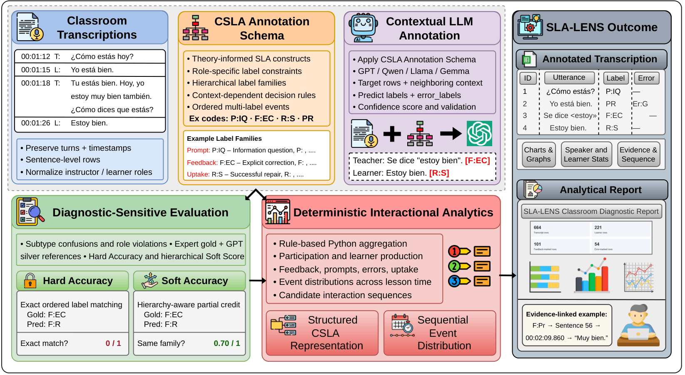

# SLA-LENS: From Classroom Transcripts to CSLA-Informed and Evidence-Linked L2 Interaction Analytics

**Research software and supplementary materials for the SLA-LENS paper.**

**Authors:** Nemika Tyagi, Olga Kellert, Phanos Kareen, and Nelvin Licona-Guevara  
**Research data inquiries:** [olga.kellert@asu.edu](mailto:olga.kellert@asu.edu)  

## Abstract

What happens after a learner makes an error, and how does the instructor's response shape the next turn? Investigating these exchanges across classrooms requires context-sensitive annotation that is difficult to scale manually. We introduce SLA-LENS, an end-to-end LLM-assisted framework that connects classroom transcripts to structured pedagogical annotations and evidence-linked descriptive analytics. Grounded in interactionist Second Language Acquisition (SLA) theory, its annotation schema captures second language learner errors, pedagogical functions, and uptake or repair while accounting for speaker roles, conversational context, and hierarchical labels. We apply the framework to 40 authentic online L2 Spanish classroom transcripts comprising over 21,000 sentence-level instances. We evaluate proprietary and open-weight LLMs, including task-specific QLoRA adaptation, using expert-reviewed gold annotations, held-out silver data, and metrics sensitive to different types of annotation error. A deterministic reporting layer generates reproducible visualizations of participation, feedback, learner errors, uptake, and temporal interaction patterns, linked to supporting transcript evidence. By making these patterns accessible and inspectable, SLA-LENS supports systematic classroom discourse research, pedagogical reflection, and curriculum design.

## SLA-LENS framework



*Figure 1. Overview of SLA-LENS. Classroom transcripts are structured into sentence-level rows and annotated with context-sensitive, role-constrained CSLA labels using an LLM. The annotation engine is evaluated against expert-reviewed gold and GPT-generated silver references using exact, hierarchical, and diagnostic-sensitive measures. A separate deterministic Python component transforms annotated CSV files into descriptive participation, feedback, error, uptake, and temporal analyses. Outputs include an inspectable annotated transcript and an evidence-linked HTML/PDF report. Candidate event associations are proximity-based, not verified causal relations.*

SLA-LENS is intended for SLA researchers, educators, curriculum designers, language-program directors, and researchers studying educational discourse. Its analytics describe observed annotations; they do **not** establish learner proficiency, learning gains, instructional effectiveness, or causal effects.

## Repository contents

```text
.
├── README.md
├── annotation.py                 # GPT-based contextual annotation
├── evaluation.py                 # Annotation evaluation metrics
├── slalens_report_gen.py         # Deterministic HTML/PDF reporting
├── annotation_guidelines.md      # CSLA labels and decision rules
├── data_card.md                  # Corpus documentation and partitions
├── corpus_statistics.md         # Aggregate statistics across 40 transcripts
├── DATA_ACCESS.md               # Restricted-data policy and contact
├── sample_input.txt             # Example transcript; publication clearance required
├── images/
│   └── slalens_pipeline.png      # Main framework figure
└── sample_output/
    ├── sample_annotated.csv
    ├── index.html
    ├── sample_diagnostic_report.pdf
    ├── charts/
    ├── error_frequencies.csv
    ├── label_frequencies.csv
    ├── learner_statistics.csv
    ├── speaker_statistics.csv
    ├── sample_evidence_index.csv
    └── sequence_links.csv
```

**Release note:** The example transcript and any derived report or evidence CSV must be synthetic or cleared for public redistribution before publishing this repository. 

## Corpus and evaluation design

The corpus comprises **40 online L2 Spanish classroom and tutoring transcripts (21,835 sentence-level rows)**. The designated model-adaptation partition contains **35 transcripts (19,214 rows)**, and the held-out silver partition contains **five transcripts (2,621 rows)**. One of the five held-out transcripts also has an **expert-reviewed 653-row gold reference**. Gold and silver annotations overlap at the transcript level but are evaluated separately against human-reviewed and GPT-generated references, respectively.

The original participant-derived corpus and annotations are **not publicly distributed**. De-identified materials may be considered for research access subject to institutional approval and applicable agreements. See [DATA_ACCESS.md](DATA_ACCESS.md), [data_card.md](data_card.md), and [corpus_statistics.md](corpus_statistics.md).

## Requirements

Python **3.10+** is a suggested starting point; the original environment has not been independently verified. Install the dependencies used by the provided scripts:

```bash
python -m pip install openai pandas python-docx tqdm numpy matplotlib
```

For optional PDF export, install **Google Chrome** or **Microsoft Edge**; the report generator invokes a local headless browser. HTML generation does not require either browser.

## 1. Annotate a transcript

`annotation.py` accepts `.txt`, `.vtt`, and `.docx` transcripts and calls the GPT-4.1 API. Configure the script's path constants:

```python
INPUT_DIR = Path("path/to/transcripts")
OUTPUT_DIR = Path("path/to/annotated_outputs")
INTERMEDIATE_DIR = Path("path/to/checkpoints")
```

Set the `OPENAI_API_KEY` environment variable locally, without committing credentials. Place transcript files in `INPUT_DIR`, then run:

```bash
python annotation.py
```

The annotation process uses **12 target rows**, up to **five preceding** and **two following** contextual rows, role-sensitive CSLA rules, and resumable checkpoints. API calls may incur charges. Restricted participant transcripts must not be sent to external services without appropriate authorization.

The script can also produce auxiliary `repair_labels` for conversational repair organization. The paper's evaluated annotation outputs are `labels` and `error_labels`.

## 2. Evaluate annotations

`evaluation.py` compares reference and predicted annotated CSVs. Edit its configuration:

```python
GOLD_FILE = Path("path/to/reference.csv")
PRED_FILE = Path("path/to/predicted.csv")
OUTPUT_DIR = Path("path/to/evaluation_results")
OUTPUT_PREFIX = "example"
```

Then run:

```bash
python evaluation.py
```

The evaluator reports exact ordered-label **Hard Accuracy**, hierarchy-aware **Soft Score**, **Feedback F1**, **Uptake/Repair F1**, **Error Detection F1**, **Error Hard Accuracy**, and invalid-label/role-violation checks. Gold and silver comparisons should be run separately. The full restricted reference data and model prediction files are not included in this public package.

## 3. Generate the analytical report

`slalens_report_gen.py` accepts an annotated CSV with at least `sentence_id`, `start_time`, `end_time`, `speaker_role`, `speaker`, `sentence`, `labels`, and `error_labels`. Edit:

```python
INPUT_CSV = Path("sample_output/sample_annotated.csv")
OUTPUT_DIR = Path("path/to/generated_report")
```

Ensure the script's `pdf_path` filename is configured (for example, `diagnostic_report.pdf`) before PDF export. Then run:

```bash
python slalens_report_gen.py
```

Open `OUTPUT_DIR/index.html` in a local browser and keep the generated `charts/` directory beside it. The script generates descriptive visualizations, learner-level statistics, frequency tables, sequence links, an evidence index, and `summary.json`; it attempts a PDF export if Chrome or Edge is available.

The included [HTML example](sample_output/index.html) and [PDF example](sample_output/sample_diagnostic_report.pdf) illustrate the report format. Generated results can differ if the input data or code version changes.

**Candidate sequence associations:** The report searches forward for the first eligible target within **four intervening rows**, stopping when another source event occurs. It examines learner error → corrective feedback, instructor feedback → learner uptake, and instructor prompt → learner response. These are proximity-based candidates, **not verified interactional episodes or causal relationships**.

## Interpretation and limitations

- Counts generally describe annotated **sentence rows**, not speaking duration; repeated timestamps may limit time-based interpretation.
- Learner-level error incidence can be normalized per learner row, but is **not a proficiency score**.
- Rare subtypes, ASR artifacts, role errors, and ambiguous interactional context can affect annotation quality.
- The reporting layer computes statistics from supplied annotations **without additional LLM-generated narrative conclusions**.
- Public examples and aggregate statistics do not substitute for the restricted gold/silver references or independently reproduce the paper's model-comparison scores.

## Data access and privacy

The original 40-transcript corpus, including participant-derived annotations and gold/silver reference files, is restricted institutional research data. **It is not openly licensed or publicly downloadable.** Qualified researchers may request consideration of de-identified data access, subject to institutional approval, consent restrictions, and any required data-use agreement. Access is not guaranteed.

For requests, contact **[olga.kellert@asu.edu](mailto:olga.kellert@asu.edu)** and consult [DATA_ACCESS.md](DATA_ACCESS.md).

## Citation

Please cite the accompanying paper if you use SLA-LENS:

> Tyagi, Nemika; Kellert, Olga; Kareen, Phanos; and Licona-Guevara, Nelvin. *SLA-LENS: From Classroom Transcripts to CSLA-Informed and Evidence-Linked L2 Interaction Analytics.*

## License and Reuse

SLA-LENS is released under the **MIT License**. This covers the original Python annotation, evaluation, and analytical-report generation scripts, unless otherwise indicated. See [LICENSE](LICENSE).

Original project documentation, the framework figure, and publicly released example datasets and reports are made available under the **Creative Commons Attribution 4.0 International (CC BY 4.0)** license, where the project has the necessary rights to authorize reuse. See [LICENSE-DATA.md](LICENSE-DATA.md).

The underlying corpus of 40 classroom transcripts, including participant-derived annotations and evaluation references, is **not publicly licensed or distributed**. Access may be considered for qualified researchers subject to institutional approval, participant-consent restrictions, and applicable data-use agreements. See [DATA_ACCESS.md](DATA_ACCESS.md).

